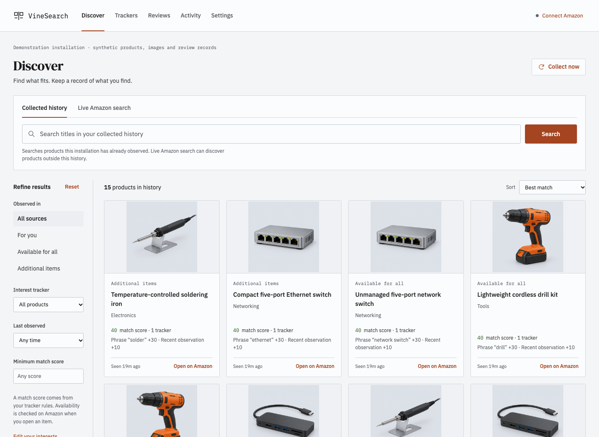
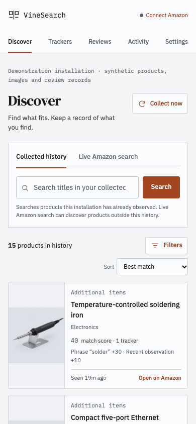
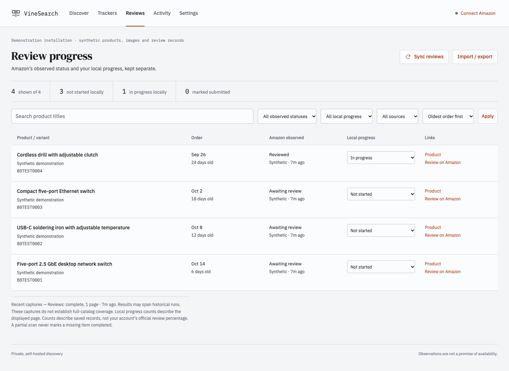
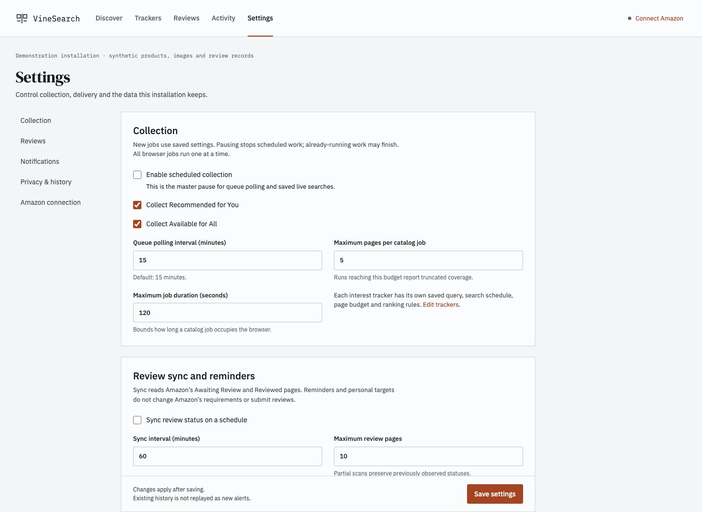

# VineSearch

Find the Vine products worth paying attention to, from your own server.

VineSearch is a self-hosted discovery and review-progress dashboard for one Amazon.com Vine account. It searches collected history, queues fresh Additional Items searches, watches RFY/AFA, and ranks products against editable interests. A dedicated server browser handles collection, so your everyday browser can stay closed.

Version 0.1.0 is undergoing release verification. The implemented interface and synthetic tests are available; live Amazon verification, the public image installation and final independent review are recorded separately in [release verification](docs/release-verification.md). This status will change only when those checks have evidence.



## Use it

Open the dashboard and connect Amazon through its temporary login browser. Sign in on Amazon normally, including MFA. Once actual Vine access is detected, the viewer closes and the dedicated profile continues headlessly. Reconnect uses the same flow and preserves history.

Search **Collected history** for products already observed, or select **Live Amazon search** to queue a new Additional Items query. Every result carries observation time and source, and each run shows its page budget and completion state. A truncated search shows only what it visited; no result guarantees current orderability.

Trackers combine positive phrases, any/all matching, exclusions, observed categories and editable weights. Networking, electronics, making/tools, home improvement and family examples are ordinary editable instance data. New matches can enter an optional durable notification queue; the initial catalog is a baseline, not a flood of alerts.

| On a phone | Review progress |
| --- | --- |
|  |  |

Review progress shows order age, variants, observed Amazon status and local progress separately. A local “marked submitted” action does not submit a review or prove Amazon approval. Import/export handles a previewed metadata whitelist and excludes drafts, review bodies, notes, photos and credentials.

## Run from source

The current source installation requires Docker with Compose and uv for setup. From this checkout:

```sh
uv sync --dev
uv run python -m vine_search setup
docker compose build
docker compose up -d
```

Open [the local dashboard](http://127.0.0.1:8765). Setup creates a private internal key; Compose starts separate web and collector roles with persistent data and session volumes. For phone access, bind to the server’s private Tailscale address and allow its exact hostname. The [operation guide](docs/operations.md) covers private access, connect/reconnect, updates, backup/restore and troubleshooting.

## Behavior you can change

Collection defaults to 15-minute RFY/AFA polling, five pages per job and a two-minute runtime budget. Saved live searches have their own schedules and page limits. Review sync defaults to hourly; reminders, personal targets and notification delivery are optional. Settings explain when changes take effect, and cleanup requires preview and explicit confirmation.



Notifications support webhooks and ntfy, immediate or digest delivery, quiet hours and opt-in relist alerts. URLs and credentials are masked in read APIs. See [notification setup](docs/notifications.md), including the external wake-up relay tradeoff for instant iOS notifications from self-hosted ntfy.

## Where data goes

Amazon authentication stays in the collector’s private volume, which the web role does not mount. SQLite keeps observations, trackers, jobs, settings and review metadata on the installation. There is no telemetry, third-party analytics, shared inventory provider, mandatory extension, subscription or AI service.

Amazon is contacted for collection. The default image proxy/cache loads approved Amazon images through the server; direct-image mode contacts Amazon/CDNs from the viewing device, and hidden-image mode disables them. Optional notifications send selected metadata to the destination you configure. Fonts and interface assets are bundled locally.

The dashboard is for an operator-controlled private network. Public source does not make a personal dashboard safe to expose without an access layer. VineSearch neither orders products nor drafts or posts reviews. Amazon layout changes, account challenges and inventory changes can interrupt collection.

## Architecture and development

Python, FastAPI, SQLite and Playwright form a single application image with separate web and collector processes. A leased database queue and profile lock serialize browser work. The login viewer is temporary, capability-scoped and proxied through the app origin. [Architecture](docs/architecture.md) describes identity, coverage, recovery and delivery boundaries; [DESIGN.md](DESIGN.md) records the neutral visual system.

```sh
uv run playwright install chromium
uv run ruff check .
uv run mypy src
uv run pytest
uv run python -m vine_search.verify --mode fixture --report data/fixture-verification.json
```

Live verification uses the dedicated session and exits nonzero when authentication is missing:

```sh
uv run python -m vine_search.verify --mode live --report data/live-verification.json
```

See [contributing](CONTRIBUTING.md) for verification and sanitized bug reports. The screenshots above are captures of the implemented app with explicitly synthetic records and generated product illustrations; they contain no account inventory. Mobile captures are resized Chromium viewports, not physical-phone evidence.

## License

VineSearch application source is [MIT licensed](LICENSE). Redistributed dependencies, fonts and container components retain their own licenses; see [third-party notices](THIRD_PARTY_NOTICES.md). Amazon and Vine are trademarks of their respective owners. This project is independently maintained and is not an Amazon service.
