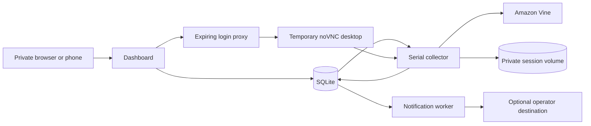

# Architecture

VineSearch serves one Amazon.com Vine account per installation. The web process
reads SQLite and queues structured work; the collector process owns a dedicated
Playwright Chromium profile. Browser requests never run inside dashboard requests.

## Observation and identity

Products are identified by marketplace and observed ASIN. A sighting joins that
identity to a run and scope, preserving first/last observation and which pages
were visited. RFY, AFA and each live query have separate scopes. Complete traversal
means the pages Amazon exposed within that scope; it does not establish global
catalog completeness or guarantee that a product remains orderable.

Runs distinguish complete, partial, truncated, failed, cancelled and needs-login.
Only complete scans establish absence in their own scope. Historical search uses
SQLite full-text search. Live results filter by the exact job's recorded sightings,
so a historical title match cannot masquerade as a newly observed live result.

Review records retain observed identity, variant, order date, raw status,
capture time and source. Local progress is separate. Multiple orders can share an
ASIN, and provisional identities remain explicit when Amazon supplies no order ID.
Missing rows from incomplete review scans never imply review completion.

Product and review visibility are independent local fields. Hiding a record
does not erase its sightings, observed review status or local progress. Bulk
visibility updates validate every requested identity before applying the batch.
Review pictures use the same approved image hosts and privacy modes as products.

## Work ownership and recovery

SQLite transactionally claims one leased browser job. The collector holds a
process file lock for its profile and a browser mutex for each operation; login,
connection checks and collection use that same owner. The web service only proxies
an internal authenticated control API. It cannot mount or serve the session volume.

Jobs and schedules survive process restarts. Expired leases receive bounded
retries, while authentication failures require reconnect rather than repeated
login attempts. Scheduled work respects the collection pause; pending manual
requests remain visible. The notification worker runs independently of browser
navigation so a slow Amazon page cannot block dashboard requests or delivery.

Manual and scheduled Additional Items searches have no overall page or time
cap. RFY/AFA queue collection and review sync retain their configured bounds. Individual navigation timeouts, repeated-page detection,
authentication stops and cancellation remain active. Captured observations are
committed when a scan terminates. A process crash before that commit can require
retrying the job; this is not a per-page crash checkpoint.

Read-only product-detail jobs use the saved ASIN and observed listing page. The
collector finds that specific card, opens only its See details control, and
extracts bounded text, variants, approved images and observed ETV. A missing ETV
is null, not zero. Results must match the requested product or an explicitly
observed selected child of a parent card. No request-product or ordering control
is activated, and unavailable or changed layouts return explicit failure states.

## Connection

Connect Amazon starts a temporary Xvfb desktop, Chromium, x11vnc and noVNC inside
the collector. An expiring capability authorizes the viewer through the dashboard
origin. VNC ports are never published. HTTP-only, scoped cookies carry the viewer
capability; the internal service key never enters browser JavaScript.

Connection is accepted only after the browser reaches an approved Amazon host and
the signed-in Vine interface is detected. Profile existence is insufficient.
Cancel, timeout and completion close viewer processes and revoke access. Subsequent
collection reuses the saved profile and an atomic, mode-0600 Amazon cookie
snapshot headlessly; the snapshot retains session cookies that Chromium would
otherwise discard on exit. Neither is mounted by the web role. MFA and challenges remain normal
operator interactions inside Amazon's browser.

## Ranking and delivery

Editable instance trackers score positive phrases, observed categories and
freshness. Exclusions veto matches; unknown categories cannot satisfy a category
restriction. Each product carries the rules contributing to its score.

The initial completed scope establishes a baseline. Enabling delivery and editing
trackers baseline existing records, preventing retrospective alert floods.
Retention preserves alert identity tombstones so deleting old display history
does not turn the same ASIN into a new alert. Relist alerts require opt-in.

The durable outbox supports webhook JSON and ntfy, bounded retry/backoff,
immediate or digest delivery, timezone-aware quiet hours, and visible delivery
state. Delivery is at least once: a process crash after the receiver accepts a
request but before acknowledgement reaches SQLite can cause a repeated request.
Consumers should honor the supplied idempotency identity.

## Privacy and security boundaries

There is no telemetry, analytics, shared inventory service, AI provider, ordering
or review posting. Amazon is contacted for collection. Optional notification
destinations receive selected product/review metadata; configuration requires an
explicit operator choice. Destination URL and authorization token are write-only
in normal read APIs and remain private in backups.

Image mode defaults to an installation-side proxy/cache restricted to Amazon
image hosts, with response type/size and total cache limits. Direct mode sends
image requests from the viewing device to Amazon/CDNs. Hidden mode loads no
product images. Fonts and interface assets ship locally.

The dashboard assumes operator-controlled private access. The default port binds
to loopback, permitted hostnames are explicit, state changes require a signed
request-forgery token, and cross-origin writes are rejected. Listing content is
escaped and external links are constrained to Amazon. Internet exposure requires
an operator-managed authentication layer.

See [the API and schema contract](api-contract.md), [operation guide](operations.md),
and [release evidence](release-verification.md).
